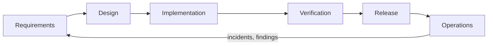

# Secure Development Lifecycle

> A secure development lifecycle embeds security activities into every stage of building software, so that security is a property of the process and not an inspection at the end.

## Overview

Teams that treat security as a final gate tend to find problems when they are most expensive to fix: after architecture is set, after customers depend on behavior, and under release pressure. A secure development lifecycle (SDL, sometimes called secure SDLC or "shift-left" practice) moves the work earlier and spreads it across the whole flow.

The idea is simple. At each stage of delivery, ask what security activity is cheap and effective there. Requirements are the place to decide what must be protected. Design is the place to find structural flaws. Implementation is the place to prevent common coding errors. Testing is the place to verify controls work. Release and operations are where you detect and respond.

An SDL is not a heavyweight bureaucracy. For a small team it can be a short checklist, a few automated checks, and a habit of asking the right questions. The goal is that the secure path is also the easy path, and that evidence of security work is a by-product of normal delivery, not a separate project.

## Core Concepts

### Stages and activities



| Stage | Security activities | Output |
|-------|--------------------|--------|
| Requirements | Identify sensitive data and compliance needs; write abuse cases and security requirements | Security acceptance criteria |
| Design | [Threat modeling](./threat-modeling.md); choose secure patterns; review trust boundaries | Threat model, design decisions |
| Implementation | Secure coding standards, linting, secrets scanning, peer review | Reviewed code |
| Verification | Static analysis, dependency scanning, dynamic testing, security tests, targeted manual review | Findings triaged and tracked |
| Release | Artifact signing, configuration checks, release sign-off for high-risk changes | Verified, traceable release |
| Operations | Monitoring, patching, incident response, vulnerability disclosure handling | Fast detection and recovery |

The loop at the end matters. Incidents and findings feed back into requirements and standards. Without the loop, the same flaw recurs.

### Types of automated testing

Automated tools cover different ground. Use several, and understand what each cannot see.

| Technique | What it does | Strength | Limitation |
|-----------|--------------|----------|------------|
| Static analysis (SAST) | Analyzes source without running it | Early feedback, points to code lines | False positives; weak on logic and authorization flaws |
| Software composition analysis (SCA) | Matches dependencies to known vulnerabilities | Finds known-vulnerable components | Only known issues; reachability unclear |
| Secrets scanning | Detects credentials in code and history | Fast, low noise | Cannot find secrets in unusual formats |
| Dynamic analysis (DAST) | Probes a running application from outside | Finds runtime and configuration issues | Limited coverage; needs a running environment |
| Interactive or runtime instrumentation | Observes behavior during tests | Better context | Tooling complexity |
| Fuzzing | Feeds many malformed inputs to a parser or API | Finds crashes and parsing flaws | Needs harnesses; time and compute |
| Infrastructure-as-code scanning | Checks templates and manifests for risky settings | Catches misconfiguration before deploy | Rule sets need tuning |
| Manual review and penetration testing | Human reasoning about design and abuse | Finds logic flaws tools miss | Expensive, point-in-time |

No scanner reliably finds broken authorization, because it depends on business rules the tool does not know. That is why authorization tests must be written by humans who understand the domain. See [Authentication, Authorization and Cryptography Basics](./authentication-authorization-and-cryptography-basics.md).

### Security requirements as testable statements

Vague: "The system must be secure."

Testable:

- "A user can read only invoices belonging to their organization."
- "Password reset tokens expire in a short, defined window and are single use."
- "No endpoint accepts requests without authentication except those on an explicit allowlist."
- "Uploaded files are limited in size and type and never executed."

Each can be turned into an automated test. Requirements you cannot test will not stay true.

### A security test in practice

```python
# Pytest-style authorization regression test
def test_user_cannot_read_other_orgs_invoice(client, org_a_user, org_b_invoice):
    response = client.get(
        f"/invoices/{org_b_invoice.id}",
        headers=auth_header(org_a_user),
    )
    assert response.status_code == 404   # no existence leak, no data

def test_unauthenticated_request_is_rejected(client):
    response = client.get("/invoices/123")
    assert response.status_code == 401
```

Tests like these encode the threat model and fail loudly if someone later weakens a check.

### Risk-based review

Not every change needs the same scrutiny. Use risk to route effort.

Higher-risk changes include:

- Authentication, session, or authorization logic
- Cryptographic code or key handling
- New external entry points or integrations
- Handling of sensitive or regulated data
- Build, deployment, and infrastructure permissions
- Parsers for untrusted formats

For those, require a security-aware reviewer. For routine changes, rely on automation and ordinary code review. See [Quality Gates and Code Review](../11-testing-quality/quality-gates-and-code-review.md).

### Security champions

A small central security team cannot review everything. A common pattern is to designate a **security champion** in each product team: a developer with extra training who raises questions early, triages findings, and links the team to specialists. The role works when it is recognized and given time, and fails when it is a title added to someone's existing workload.

### Vulnerability management and response

Plan for the day a flaw is reported or exploited.

- Publish a way for outsiders to report vulnerabilities, and commit to acknowledging reports.
- Define severity levels and target times to remediate for each.
- Keep an incident response plan, with roles, communication paths, and decision authority, and rehearse it.
- After an incident, hold a blameless review that ends in concrete changes to process and controls.
- Track metrics that reflect outcomes: time to fix, age of open critical findings, recurrence of the same class of flaw.

Avoid vanity metrics such as raw counts of findings. They reward noisy tools and punish thorough scanning.

## Trade-offs

| Choice | Benefit | Cost |
|--------|---------|------|
| Blocking CI on security findings | Prevents known-bad merges | Slower pipelines; developer friction when tools are noisy |
| Advisory-only findings | No friction | Findings are ignored over time |
| Many scanners | Wider coverage | Overlapping, inconsistent results; triage load |
| Mandatory threat model per feature | Design-level coverage | Overhead; can become a rubber stamp |
| Central security review | Consistent expertise | Bottleneck; teams offload responsibility |
| Embedded champions | Scales, builds skill | Depth varies; needs sustained support |
| Frequent penetration tests | Fresh outside perspective | Cost; findings arrive late if used as the only control |
| Bug bounty program | Broad researcher attention | Triage workload; needs a mature fix process first |

The recurring tension is signal against friction. A gate that blocks on false positives trains people to bypass it. Tune rules, fix noisy checks, and make exceptions explicit, time-limited, and recorded.

## Failure Modes

**Security as the last stage.** A review a week before launch finds design flaws that cannot be fixed in time, so risk is accepted by default. Prevent by involving security at design.

**Tool theater.** Scanners run, dashboards fill, nobody fixes anything. Measure fix time and recurrence, not scan counts. Assign ownership to findings.

**Alert fatigue.** Thousands of low-quality findings train people to ignore the tool. Start with a small set of high-confidence rules and expand.

**Checklist compliance without understanding.** Teams satisfy a control on paper while the underlying risk remains. Prefer controls that can be verified by tests and evidence over ones satisfied by attestation.

**Exceptions that never expire.** A waiver granted for one release lives forever. Give every exception an owner and an expiry date.

**No feedback loop.** Incidents are patched but the class of flaw remains. After each incident, ask which control would have prevented or detected it, and add that control.

**Blame culture.** If reporting a mistake is punished, mistakes are hidden, and the lessons disappear. Run blameless reviews.

**Ignoring operations.** Security ends at deployment in many plans. Production is where attacks happen: log the right events, alert on anomalies, and practice response. See [Reliability Testing and Chaos Engineering](../11-testing-quality/reliability-testing-and-chaos-engineering.md) for the practice of rehearsing failure.

## In Practice

### A minimal SDL for a small team

1. **Before building:** list the sensitive data the feature touches and the actors who use it. Write three abuse cases.
2. **During design:** run a short [threat model](./threat-modeling.md) for features that add a boundary, a data type, or a new privilege.
3. **During coding:** follow a short secure coding standard. Use shared helpers for authorization, data access, and outbound requests.
4. **In CI:** run secrets scanning, dependency scanning, static analysis with a tuned rule set, and the authorization test suite. Block on high-confidence critical findings.
5. **In review:** require a security-aware reviewer for the higher-risk categories above.
6. **At release:** build once, sign the artifact, and deploy the same artifact everywhere.
7. **In operations:** monitor authentication failures and access denials, keep a patch cadence, and maintain a rehearsed incident plan.
8. **After incidents:** hold a blameless review and add a control.

### Definition of done additions

- [ ] Threat model updated if boundaries or data flows changed.
- [ ] Authorization tests cover new endpoints and roles.
- [ ] No new secrets in code; new credentials registered with an owner.
- [ ] New dependencies reviewed.
- [ ] Logging added for security-relevant events, with sensitive fields redacted.
- [ ] Documentation of any accepted risk, with owner and review date.

### Developer vs. engineer

A developer waits for the security team to find problems. An engineer builds the checks into the pipeline, writes the tests that encode the requirements, and treats a vulnerability as a signal about process, not just about one line of code.

### When AI generates code

AI assistance accelerates output, which raises the volume that review and automation must absorb. Keep the same gates. Do not weaken them for generated code, and do not assume it was reviewed because it compiled and passed tests. Ask the assistant to produce the security tests alongside the implementation, then check that those tests would actually fail if the control were removed. Reviewers should read generated code with the same suspicion they would apply to a contribution from an unfamiliar contractor.

## Further Reading

- Michael Howard and Steve Lipner, *The Security Development Lifecycle*. The account of a large-scale SDL program.
- Gary McGraw, *Software Security: Building Security In*, which introduces the idea of touchpoints across the lifecycle.
- NIST, *Secure Software Development Framework (SSDF)*, SP 800-218.
- OWASP Software Assurance Maturity Model (SAMM) and the OWASP Application Security Verification Standard (ASVS), both at owasp.org.
- Adam Shostack, *Threat Modeling: Designing for Security*, for the design stage.

Back to the section: [Security](./README.md)
