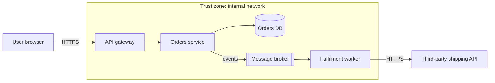

# Threat Modeling

> Threat modeling is the structured practice of asking what can go wrong with a system before it does, so that security effort goes to the risks that matter.

## Overview

A threat model is a shared, written understanding of what you are protecting, who might attack it, how, and what you will do about it. It is not a certification or a document for auditors. It is a thinking tool that makes security assumptions explicit while they are still cheap to change.

Most security defects are design defects. A missing authorization check, an internal service that trusts any caller, a password reset flow that leaks account existence: none of these are typos. They are decisions, usually made implicitly. Threat modeling surfaces those decisions early, when changing them costs a conversation rather than a migration.

The practice answers four questions, in this order:

1. What are we building?
2. What can go wrong?
3. What are we going to do about it?
4. Did we do a good enough job?

Everything else in this topic is technique for answering those questions with discipline. A developer implements the feature as specified. An engineer asks what the specification forgot to say about misuse, and writes the answer down.

## Core Concepts

### Assets, actors, and trust boundaries

An **asset** is something worth protecting: customer data, credentials, signing keys, availability of a payment path, the integrity of a financial ledger. Start here. Without assets, threats are abstract.

An **actor** is anyone who interacts with the system: customers, administrators, support staff, other services, third-party vendors, and attackers. Attackers are not one group. A curious customer, an automated bot, a malicious insider, and a compromised dependency have different capabilities and goals.

A **trust boundary** is a line where the level of trust changes. Data crossing a boundary must be treated differently on each side. Typical boundaries:

- Internet to your edge (load balancer, API gateway)
- Client to server (the browser is never trusted)
- Service to service, especially across teams or networks
- Application to database or message broker
- Your code to third-party code and services
- Production to build and deployment systems

Most threats live on or near trust boundaries. If you only have time to examine one thing, examine what crosses them.

### Data flow diagrams

A data flow diagram (DFD) is the usual input. It shows processes, data stores, external entities, and the flows between them, with trust boundaries drawn over the top. It does not need to be pretty.



Each arrow crossing a zone is a place to ask: who is on the other end, how do we know, and what happens if they lie?

### STRIDE

STRIDE is a mnemonic for six threat categories. It is a checklist for prompting thought, not a classification scheme to be argued over.

| Letter | Threat | Violates | Example question |
|--------|--------|----------|------------------|
| S | Spoofing | Authentication | Can a caller pretend to be another user or service? |
| T | Tampering | Integrity | Can data be modified in transit or at rest without detection? |
| R | Repudiation | Non-repudiation | Can an actor deny an action because we have no reliable record? |
| I | Information disclosure | Confidentiality | Can data leak through responses, logs, errors, or caches? |
| D | Denial of service | Availability | Can one actor exhaust a shared resource? |
| E | Elevation of privilege | Authorization | Can a low-privilege actor gain higher privilege? |

Apply STRIDE per element: walk each process, store, and flow in the diagram and ask which categories apply. Not every category applies to every element. A data store is not spoofed in the same way a process is.

### Attack trees

An attack tree puts the attacker's goal at the root and decomposes it into alternative or required sub-steps. It is useful for a single high-value asset.

```
Goal: read another customer's invoice
├── Guess or enumerate invoice IDs (OR)
│   └── Requires: sequential IDs AND no ownership check
├── Steal a valid session (OR)
│   ├── XSS on any page of the same origin
│   └── Session token in logs or URLs
└── Abuse an internal endpoint (OR)
    └── Requires: network access AND missing service authentication
```

The tree makes defenses easy to place: removing one required condition on a branch closes it.

### Risk and prioritization

Not every threat deserves a fix. Rank by likelihood and impact, then decide. Keep the scale simple (low, medium, high) and explain the reasoning. False precision, such as a numeric score derived from invented probabilities, adds ceremony without accuracy. Frameworks such as DREAD exist but are widely regarded as inconsistent; many teams prefer plain qualitative ratings with written rationale.

For each accepted threat, choose a response:

- **Mitigate**: add a control that reduces likelihood or impact.
- **Eliminate**: remove the feature, data, or flow that creates the threat.
- **Transfer**: shift the risk (insurance, a managed service with contractual responsibility).
- **Accept**: record the decision, the owner, and a review date.

Eliminating is underrated. Data you do not collect cannot be stolen.

## Trade-offs

| Choice | What it buys | What it costs |
|--------|--------------|---------------|
| Early, per-feature modeling | Cheap design changes | Time at the moment teams feel most pressure to ship |
| Large formal workshop | Broad coverage, shared understanding | Scheduling cost; models go stale quickly |
| Lightweight, in-PR modeling | Stays current, builds habit | Shallower; depends on facilitator skill |
| Exhaustive STRIDE on everything | Completeness | Fatigue, long lists nobody acts on |
| Targeting only high-risk changes | Focus | Risk of misjudging which changes are high risk |
| Heavy tooling | Consistency, traceability | Tool maintenance; diagrams rot when tool is separate from code |

The core tension is depth against cadence. A model that is perfect and never updated is worse than a rough one revisited each quarter.

Another trade-off: modeling the attacker you can imagine versus the attacker you will actually meet. Teams tend to model sophisticated adversaries and miss mundane ones, such as credential stuffing, scraping, or an over-privileged internal tool. Weight your effort toward the common and boring.

## Failure Modes

**The model is written once and never revisited.** The architecture changes, a new integration appears, and the diagram describes a system that no longer exists. Detect it by comparing the diagram to the current deployment topology. Prevent it by storing the model in the repository next to the code and making it part of the definition of done for changes that add flows or boundaries.

**The model lists threats without owners or actions.** A spreadsheet of forty findings with no tickets is decoration. Every accepted mitigation becomes a tracked work item; every accepted risk has a named owner.

**Scope is too large.** "Model the whole platform" never finishes. Scope to one feature, one service, or one data flow per session.

**Only security specialists participate.** They do not know the system well enough. The people who built it know where the shortcuts are. Include developers, an operator, and ideally someone who handles support escalations.

**Trust assumptions are implicit.** "The internal network is safe" is a classic. An attacker who lands on any one internal host inherits that trust. Write assumptions down and challenge each one.

**Mitigation without verification.** A control was designed but never tested. Add a test or a review step that proves it exists and works: an authorization test for each role, a negative test for each validation.

**Modeling ignores abuse of legitimate features.** Threats are not only exploits. A referral program can be farmed, a free trial can be cycled, a password reset can be used to harass. Include misuse cases written from the perspective of an actor who follows the rules and breaks the intent.

## In Practice

### A lightweight session

Run this in 60 to 90 minutes for one feature.

1. **Draw** the data flow on a whiteboard or in text. Mark trust boundaries. (15 minutes)
2. **List assets** the feature touches and the actors involved. (10 minutes)
3. **Walk each flow** with STRIDE as a prompt. Write every plausible threat as a sentence. Do not solve yet. (30 minutes)
4. **Rank** threats as low, medium, or high with one line of reasoning. (10 minutes)
5. **Decide** mitigate, eliminate, transfer, or accept for each high and medium item. Create tickets. (15 minutes)
6. **Record** the diagram, threats, and decisions in the repository, for example `docs/threat-models/checkout.md`.

### Worked example: password reset

Flow: user submits email, system sends a link with a token, user opens the link and sets a new password.

| Threat | Category | Response |
|--------|----------|----------|
| Response differs for known vs unknown email, revealing accounts | Information disclosure | Return the same message and similar timing for both |
| Token is guessable or reusable | Spoofing, elevation | Generate with a cryptographically secure random source, single use, short expiry, store only a hash |
| Attacker triggers floods of reset emails to harass a user | Denial of service | Rate limit per account and per source |
| Token appears in server logs or referrer headers | Information disclosure | Avoid logging full URLs; set a restrictive referrer policy |
| Session remains valid on other devices after reset | Elevation of privilege | Invalidate existing sessions on password change |
| No record of who requested the reset | Repudiation | Log the request and completion with a stable identifier |

Six rows, one meeting, and several concrete tickets.

### Developer vs. engineer

A developer builds the reset flow described in the ticket. An engineer notices the ticket says nothing about token lifetime, session invalidation, or rate limiting, and raises those before coding. The engineer also records the answer so the next person does not rediscover it.

### When AI generates code

AI assistants produce plausible implementations of the happy path. They rarely volunteer trust-boundary reasoning. Before accepting generated code that handles input, identity, or data movement, check:

- Which trust boundary does this code sit on?
- What does it assume about the caller?
- Which threats from your model does it address, and which does it ignore?

Use your threat model as the prompt context, and as the review checklist for the output.

### Decision checklist

- [ ] Assets and actors are listed.
- [ ] Trust boundaries are drawn.
- [ ] Each flow crossing a boundary has been examined.
- [ ] Each threat has a response and an owner.
- [ ] The model lives in version control.
- [ ] A trigger exists for revisiting it (new integration, new data type, incident).

## Further Reading

- Adam Shostack, *Threat Modeling: Designing for Security*. The standard practitioner text, including the four-question framing and STRIDE usage.
- Bruce Schneier, "Attack Trees" (Dr. Dobb's Journal, 1999). The original popular description of attack trees.
- *Threat Modeling Manifesto*, a community statement of values and principles for the practice.
- OWASP Threat Modeling Cheat Sheet, available from the OWASP Cheat Sheet Series (owasp.org).
- Ross Anderson, *Security Engineering*. Broad grounding in why systems fail under adversarial pressure.

Back to the section: [Security](./README.md)
