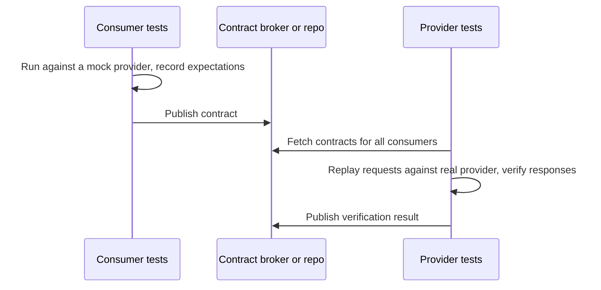

# Contract and Property-Based Testing

> Contract tests check that two independently changing components still agree on their interface, and property-based tests check that stated rules hold across many generated inputs instead of a few hand-picked ones.

## Overview

Example-based tests check specific inputs against specific outputs. They are the right default. They have two blind spots. First, you only test the examples you thought of, and bugs hide in the inputs you did not. Second, when two components are built and deployed separately, each can pass its own tests while the combination fails, because each test assumed something about the other that is no longer true.

Property-based testing addresses the first blind spot. Contract testing addresses the second. Both shift effort from "list cases" to "state rules": what must always be true of this function, and what exactly does this consumer need from that provider?

Both techniques ask for more thought up front and repay it with defects that ordinary suites miss. They are not replacements for example tests. They are complements, aimed at specific risks.

## Core Concepts

### Property-based testing

A **property** is a statement that should hold for every valid input. Instead of writing `reverse([1,2,3]) == [3,2,1]`, you write "reversing a list twice returns the original" and let a tool generate hundreds of lists to check it.

The technique comes from QuickCheck, introduced for Haskell by Koen Claessen and John Hughes in 2000. Equivalent libraries exist for most languages, such as Hypothesis for Python, fast-check for JavaScript and TypeScript, and jqwik for Java.

The workflow:

1. You describe how to generate valid inputs.
2. You state a property.
3. The tool runs it against many generated inputs.
4. If it finds a failure, it **shrinks** the input to a smaller failing case, so the report is readable.
5. The failing case is saved or reproduced via a seed, and you add it as a regular example test.

```python
from collections import Counter
from hypothesis import given, strategies as st

@given(st.lists(st.integers()))
def test_sorting_is_idempotent(xs):
    assert sorted(sorted(xs)) == sorted(xs)

@given(st.lists(st.integers()))
def test_sorting_orders_and_keeps_every_element(xs):
    result = sorted(xs)
    assert all(a <= b for a, b in zip(result, result[1:]))
    assert Counter(result) == Counter(xs)
```

Real value comes from properties about your own domain, not about the standard library.

### Common property patterns

| Pattern | Statement | Example |
|---------|-----------|---------|
| Round trip | Encode then decode returns the original | `parse(serialize(x)) == x` |
| Invariant | A condition holds after any operation | A balanced tree stays balanced; an account balance is never negative |
| Idempotence | Applying twice equals applying once | Normalizing an email address |
| Commutativity or order independence | Order of inputs does not change the result | Merging two sets |
| Oracle or reference | Compare to a simple, obviously correct version | Optimized algorithm versus brute force |
| Metamorphic | A known relation between outputs for related inputs | Adding an irrelevant filter should not increase the result count |
| No crash | The function never throws on valid input | A parser given arbitrary bytes returns an error value, not an exception |

The oracle and round-trip patterns are the easiest places to start. They need no deep specification, only a trusted counterpart.

### Stateful and model-based testing

For systems with state, generate **sequences of operations** and compare the real system with a simple model. Example: generate random sequences of `put`, `get`, and `delete` against your cache implementation and a plain dictionary. After each step, both should agree. The tool shrinks a failing sequence to the shortest one that reproduces the discrepancy. This is effective for finding bugs in data structures, protocols, and concurrent code.

### Generators matter

The quality of the test depends on the generator. If it only produces tiny positive integers, you will miss overflow. If it produces data that violates your preconditions, most runs are rejected and little is tested. Good generators:

- Produce edge values often: zero, empty collections, maximums, negative numbers, Unicode, long strings.
- Respect domain constraints by construction, not by filtering after the fact.
- Are reused across tests as shared building blocks.

### Fuzzing

Fuzzing is a close relative. A fuzzer feeds large volumes of unexpected or mutated input to a program, often guided by coverage feedback, looking for crashes and hangs. It is especially valuable for parsers and code that handles untrusted input, which links it to [Security](../10-security/README.md). Property-based testing leans on structured, valid input and explicit properties. Fuzzing leans on volume and mutation and usually checks only for crashes or sanitizer findings.

### Contract testing

In a system of services, the **consumer** calls an interface and the **provider** implements it. Integration tests across both are slow and require both deployed. Mocks on the consumer side are fast but can drift from what the provider actually does.

A **contract** is a machine-readable description of what a consumer expects from a provider: for a given request, the shape and key fields of the response. Contract testing verifies each side against the contract separately.

**Consumer-driven contracts**, the model popularized by tools such as Pact, work like this:



The consumer's tests generate the contract. The provider replays it against its real implementation. If the provider changes something a consumer relies on, the provider's build fails before release. If no consumer uses a field, the provider is free to change it, which shows who is actually affected by a change.

### Schema-based alternatives

An interface description such as OpenAPI, Protocol Buffers, or a GraphQL schema is also a contract. Tools can check compatibility between versions (for example, flag that a field was removed or a type changed) and validate that responses match the schema. This is provider-driven rather than consumer-driven. It is simpler to adopt and catches structural breaks, but it does not capture which fields each consumer actually depends on or behaviors beyond shape.

| Approach | Driven by | Catches | Misses |
|----------|-----------|---------|--------|
| Consumer-driven contracts | Consumer expectations | Breaking changes that affect real consumers | Behavior outside the contract examples |
| Schema compatibility checks | Provider's published schema | Structural breaking changes | Semantic changes (same shape, different meaning) |
| Full integration in shared environment | Real deployment | Many things, including wiring | Slow, flaky, hard to attribute |

### Compatibility rules worth knowing

Backward-compatible changes to a provider generally include adding optional fields and adding new endpoints. Breaking changes include removing or renaming fields, changing types, tightening validation, and changing the meaning of a value. Semantic changes are the dangerous ones because the schema still validates. See [Backend Engineering](../07-backend-engineering/README.md) for API versioning.

## Trade-offs

| Choice | What it buys | What it costs |
|--------|--------------|---------------|
| Property-based tests | Finds unexpected inputs; documents rules | Harder to write; needs good generators; failures can be hard to interpret without shrinking |
| Only example tests | Simple, readable | Coverage limited by imagination |
| Random generation per run | Wide exploration over time | Non-reproducible failures unless the seed is recorded; possible CI noise |
| Fixed seed in CI | Reproducible | Explores less; same inputs each run |
| Consumer-driven contracts | Independent deployment with confidence | Tooling, process, and cross-team coordination |
| Schema checks only | Cheap adoption | Misses semantic and usage-based breaks |
| Mocking provider in consumer tests without a contract | Fast | Drift risk, as covered in [Unit, Integration and End-to-End Testing](./unit-integration-and-end-to-end-testing.md) |
| Fuzzing | Finds crashes in hostile input paths | Compute time; triage effort; limited to detectable failure signals |

Property-based tests cost thinking time. Many bugs found by them are specification gaps: the team had not decided what the function should do for an empty list or a negative amount. That is a benefit, but it feels like friction.

## Failure Modes

**Weak properties.** A property so loose that a wrong implementation passes, such as "the result is a list". Detect by writing a deliberately wrong implementation and checking the property fails. Prefer properties that tie output tightly to input.

**Properties that re-implement the code.** If the property computes the expected result using the same logic, it confirms nothing. Use an independent oracle, a simpler brute-force version, or a relation between outputs.

**Generators that avoid the interesting cases.** The test passes for years because it never generated an empty string or a value near an integer limit. Review generator distributions; many libraries can report statistics on what was generated.

**Excessive filtering.** A generator discards most inputs and the test either runs very few cases or aborts. Build valid inputs constructively.

**Flaky property tests.** A failure appears once in a thousand runs, cannot be reproduced, and gets ignored. Always log the seed or failing example. Keep a saved database of failing examples if the library supports it, and convert each discovered failure into a permanent example test.

**Contract as a rubber stamp.** Consumers record a broad contract with many unused fields. Provider changes are blocked for no reason. Consumers should assert only what they actually use.

**Contracts nobody verifies.** The consumer publishes contracts but the provider pipeline does not fetch or enforce them. The mechanism exists on paper. Make verification a required step of the provider's build, and block deployment when a contract fails.

**Stale contracts.** The consumer code changes and the contract version in the broker is not updated, so verification runs against the past. Tie contract publication to the consumer's CI, and tag by branch and version.

**Semantic breakage under a valid schema.** The provider starts returning amounts in cents instead of currency units. The shape is identical; consumers are wrong by a factor of one hundred. Express meaning in the contract with example values, name fields to carry units, and add property tests on the provider for invariants.

**Using contract tests as a substitute for end-to-end checks.** They verify interface agreement, not that the system works as a whole. Keep a small number of journey tests.

## In Practice

### Adding property tests where they pay off

Good first targets:

- Serialization and parsing round trips.
- Money, date, and unit conversion code.
- Anything with a simple reference implementation to compare against.
- Data structures and caches (stateful model comparison).
- Input normalization and validation functions.

Start with one property and one function. When the tool finds a failure, treat it as information: either a bug or a missing rule in the specification. Either way, record it as an example test.

### Worked example: round trip

```python
from hypothesis import given, strategies as st

money = st.builds(
    Money,
    amount_cents=st.integers(min_value=-10**12, max_value=10**12),
    currency=st.sampled_from(["USD", "EUR", "JPY"]),
)

@given(money)
def test_money_serialization_round_trip(m):
    assert Money.from_json(m.to_json()) == m
```

If `to_json` formats cents as a float, large values lose precision, and the tool will produce a minimal failing value. That is a bug an hour of hand-written examples would likely miss.

### Adopting contract tests

1. Pick one consumer-provider pair that has caused breakage before.
2. Have the consumer record only the interactions and fields it uses.
3. Make provider verification a required CI step.
4. Establish a rule for breaking changes: expand, migrate consumers, then contract (remove).
5. Review contract failures as a signal of real coordination needs, not as noise.

### Developer vs. engineer

A developer changes a response field and runs the provider's tests, which pass. An engineer asks who consumes the field, checks the contracts or usage metrics, and sequences the change so no consumer breaks. The first fixes the code; the second owns the outcome across the system.

### When AI generates tests

- Ask for properties, not only examples. An assistant can propose properties, but check that each is non-trivial and independent of the implementation.
- Verify generators include edge values and respect domain constraints.
- Generated contracts or mocks often reflect the provider as the model imagines it. Check them against real responses or the published schema.
- When code is generated from an OpenAPI or similar schema, run schema compatibility checks in CI, since regenerated code can silently change behavior.

### Checklist

- [ ] At least one critical function has a property-based test with a non-trivial property.
- [ ] Failing seeds and examples are logged and converted into example tests.
- [ ] Every cross-team or cross-service interface has either a verified contract or a schema compatibility check.
- [ ] Provider builds fail when a contract in use is broken.
- [ ] Breaking changes follow an expand-migrate-contract sequence.
- [ ] Units and meanings are encoded in names and examples, not only in types.

## Further Reading

- Koen Claessen and John Hughes, "QuickCheck: A Lightweight Tool for Random Testing of Haskell Programs" (ICFP 2000). The origin of the technique.
- John Hughes, "How to Specify It!: A Guide to Writing Properties of Pure Functions". Practical catalogue of property patterns.
- David R. MacIver, Hypothesis documentation and articles on shrinking and property design (hypothesis.readthedocs.io).
- Pact documentation, "Consumer-driven contracts" (docs.pact.io). The reference for the consumer-driven approach.
- Ian Robinson, "Consumer-Driven Contracts: A Service Evolution Pattern" (martinfowler.com). The conceptual source of the pattern.

Back to the section: [Testing and Quality](./README.md)
