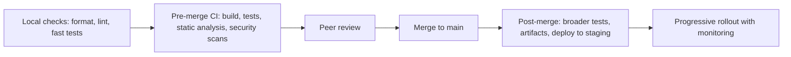

# Quality Gates and Code Review

> Quality gates and code review are the checkpoints where a change must earn its way into the main line, and their design determines whether quality is enforced, ignored or merely performed.

## Overview

Tests tell you whether code behaves as intended. Gates and reviews decide whether a change is allowed to proceed. A **quality gate** is an automated or human checkpoint with a pass or fail outcome: the build compiles, tests pass, static analysis finds no new serious issue, a reviewer approves. **Code review** is the human gate, and it does more than gate. It spreads knowledge, catches design problems no tool can see, and shapes team norms.

Good gates make the right thing the easy thing. Bad gates are slow, noisy, and routinely bypassed, which teaches the team that quality checks are obstacles. The aim is a small number of trusted checks that fail rarely for the wrong reasons, plus a review culture that is fast, specific, and respectful.

The delivery research summarized in *Accelerate* (Forsgren, Humble, Kim) associates strong technical practices, including trunk-based development, test automation, and continuous integration, with better delivery performance. Heavy, externally imposed approval processes do not show the same benefit and were not found to improve stability. That pattern guides this topic: automate what machines do well and invest human attention where judgment matters.

## Core Concepts

### The layers of a pipeline

Each layer should catch what it is cheapest at catching. Formatting belongs to a tool, not a reviewer. Logic errors belong to tests. Design and clarity belong to people. Operational surprises belong to rollout and monitoring.

### Types of automated gates

| Gate | Checks | Notes |
|------|--------|-------|
| Formatter | Consistent layout | Auto-fix; ends style arguments |
| Linter | Suspicious patterns, unused code | Tune rules; ignore noise |
| Type checker | Type errors | Strong, cheap bug class elimination |
| Unit and integration tests | Behavior | Must be fast and reliable |
| Static analysis | Bugs, complexity, security patterns | Gate on new findings, not legacy backlog |
| Dependency and license scan | Known vulnerable or disallowed packages | See [Secrets and Supply Chain Security](../10-security/secrets-and-supply-chain-security.md) |
| Secret scanning | Committed credentials | Block before merge |
| Coverage report | Tested lines in the change | Use to inform review, with caution about thresholds |
| Build reproducibility and artifact checks | Deployable output | Catches packaging errors |
| Migration checks | Schema change safety | Warn on locking or irreversible operations |

### Designing a gate that works

A gate is only useful if it is trusted. Properties of a healthy gate:

- **Reliable.** A failure means something is actually wrong. Flaky gates train people to retry or override.
- **Fast.** Feedback within minutes keeps changes small. Long waits encourage batching.
- **Actionable.** The failure message says what to fix.
- **Owned.** A named team maintains it and responds when it breaks.
- **Proportionate.** Strictness matches risk. A documentation change should not wait for the full suite.
- **Ratcheting.** For existing messy code, gate on new violations only and tighten over time. Demanding a clean slate on day one produces bypasses.

### Coverage gates

Requiring a minimum overall coverage percentage is common and contested. The weakness is that a number rewards executing lines, not checking behavior. Variants that tend to work better: require that changed lines are covered, or that coverage does not drop on a pull request, and use the report as a review aid ("this branch is untested, is that intended?"). Pair with occasional mutation testing on critical code to see whether the tests detect changes. See [Test Strategy and the Test Pyramid](./test-strategy-and-the-test-pyramid.md).

### Code review

Review serves several goals, in rough order of lasting value:

1. **Shared understanding**: at least two people know how the change works.
2. **Design and maintainability**: naming, structure, boundaries, and whether this is the right approach.
3. **Defect detection**: correctness, edge cases, concurrency, security, error handling.
4. **Consistency**: conventions and architecture.
5. **Mentoring**: both directions.

Empirical work on review at large organizations, including the case study "Modern Code Review: A Case Study at Google" (Sadowski et al., 2018), reports that the main practical benefits are knowledge sharing and maintainability as much as finding bugs. Treat review as a way to keep a codebase understandable, not only as a bug filter.

### What a reviewer looks for

A useful reading order:

1. **Intent.** Read the description. What problem does this solve? Is that the right problem?
2. **Design.** Does the change fit the system? Is there a simpler approach?
3. **Correctness.** Edge cases, error paths, concurrency, resource cleanup, idempotency.
4. **Tests.** Do they check behavior? Would they fail if the code were wrong?
5. **Security and privacy.** Input handling, authorization, logging of sensitive data.
6. **Operability.** Logging, metrics, failure handling, rollback.
7. **Readability.** Names, comments that explain why, no needless cleverness.

Leave style to tools.

### Authoring for review

The author controls review quality more than the reviewer does.

- **Small changes.** Smaller changes get faster, more careful reviews. A change of a few hundred lines is usually reviewable. A change of several thousand is skimmed.
- **A clear description.** What, why, how it was tested, what is risky, what is deliberately left out.
- **Self-review first.** Read your own diff before asking others.
- **Separate refactoring from behavior change.** Mixed changes hide bugs.
- **Link context.** Issue, design note, benchmark.

### Giving and receiving feedback

Comments should be specific, kind, and clear about severity. A helpful convention is to label them: *blocking* (must fix), *suggestion* (consider), *question* (I need to understand), *nit* (trivial, optional). Explain the reason, not only the demand. Critique the code, not the person. As an author, assume good intent, respond to every comment, and ask when something is unclear. Disagreements that go beyond two rounds are better settled in a short conversation, with the outcome recorded in the thread.

### Branch and merge policies

- Require at least one reviewer who is not the author, with stricter rules for sensitive areas.
- Use code owners for security-critical or high-risk paths.
- Require passing checks before merge, with a documented process for emergency bypass that logs who used it and why.
- Prefer short-lived branches and frequent integration. Long-lived branches accumulate merge pain and review debt.

## Trade-offs

| Choice | What it buys | What it costs |
|--------|--------------|---------------|
| Mandatory review for every change | Shared knowledge, second pair of eyes | Latency; can become rubber-stamping under volume |
| Review only for risky changes | Speed | Misjudged risk; less knowledge sharing |
| Pair or mob programming instead of async review | Immediate feedback, shared context | Scheduling cost; fewer written records |
| Strict gates (block on any warning) | Clean main line | Friction; people disable checks |
| Lenient gates (warnings only) | Flow | Warnings ignored and accumulate |
| Required coverage threshold | Visible floor | Gaming; low-value tests |
| Large pull requests | Fewer review cycles | Shallow review; higher defect leakage |
| Many small pull requests | Careful review; easy rollback | More overhead; requires planning to slice work |
| Post-merge review | Unblocks authors | Findings arrive after the code is live |

The fundamental tension is flow versus assurance. Too little checking and defects escape. Too much and people route around it. Tune using data: how often do gates catch real problems, how long do changes wait, and how often are checks bypassed?

## Failure Modes

**Rubber-stamp reviews.** Approvals arrive within seconds on a large diff. Detect by looking at review time against change size and at the count of substantive comments. Prevent with small changes, a reviewer rotation, and a norm that "approved" means "I understood this".

**Review as bottleneck.** Pull requests wait days. Authors batch work, making changes larger. Set a team expectation for first response, measure time to first review, and spread review load so it does not fall on one or two seniors.

**Noisy gates.** A linter or scanner emits hundreds of warnings, and everyone learns to ignore them. Reduce to rules that matter, fix or suppress with justification, and gate only on new findings.

**Flaky required checks.** A required check fails randomly, so people click re-run until green. Defects ride through on the retry. Quarantine the flaky check, fix it, and track retries.

**Bypass as habit.** The emergency override becomes routine. Log every bypass, review them periodically, and treat frequent use as a signal that the gate is miscalibrated.

**Style wars in review.** Reviews fill with formatting opinions. Automate formatting and adopt a style guide so people can focus on substance.

**Gate theater.** Checks exist for compliance but test nothing meaningful: coverage achieved through assertion-free tests, security scans that no one triages. Audit what each gate actually catches by tracking the defects it has found.

**Reviewer overload and unclear ownership.** Nobody feels responsible for a part of the system. Use code owners and rotate.

**Reviewing generated code at human trust levels.** A large AI-generated diff arrives looking polished and consistent. Reviewers skim because it reads well. Plausible and correct are different properties.

**Hostile or vague feedback.** Comments like "this is bad" deter contributors and teach nothing. Require specificity and explain reasons.

## In Practice

### A baseline pipeline for a service

1. Pre-commit or editor: formatter and fast linter.
2. Pre-merge CI, aiming for a runtime that people tolerate: build, type check, unit tests, integration tests, dependency and secret scans.
3. Review by one person who understands the area, with code owners for sensitive paths.
4. Merge to main triggers broader tests, artifact build, and deployment to a staging environment.
5. Progressive rollout (for example canary then wider) with automated rollback on health signals.

Measure: time from open to merge, change size, check failure rate, flaky rate, and bypass count.

### Review checklist for authors

- [ ] The description states what, why, and how it was tested.
- [ ] The change does one thing.
- [ ] Tests cover new behavior and the failure paths.
- [ ] No unrelated refactoring is mixed in.
- [ ] I have read my own diff.
- [ ] Risky parts are called out for the reviewer.
- [ ] Rollback is possible and understood.

### Review checklist for reviewers

- [ ] I understand what the change is for.
- [ ] I considered a simpler alternative.
- [ ] Error paths and edge cases are handled.
- [ ] Tests would fail if the code were wrong.
- [ ] Input handling and authorization are correct (see [OWASP Top 10 and Secure Coding](../10-security/owasp-top-10-and-secure-coding.md)).
- [ ] I could debug this at night from its logs and metrics.
- [ ] My comments are specific and labeled by severity.

### Developer vs. engineer

A developer treats review as a hurdle and optimizes for approval. An engineer treats it as the cheapest moment to find a problem, writes a change that is easy to review, and reviews others' work with attention. The engineer also fixes the class of problem: if the same comment appears five times, it becomes a lint rule or a template.

### When AI generates code

AI raises the volume of code per person and shifts where the bottleneck sits. Review capacity becomes the limit. Practical stances:

- The author owns the change. "The assistant wrote it" is not an explanation. The author must be able to explain every line.
- Review generated code for invented APIs, wrong error handling, outdated patterns, and missing authorization.
- Ask for small, focused generations. A thousand-line generated diff is unreviewable.
- Check the tests separately and skeptically. Do they check requirements or restate the code?
- Do not let AI review replace human review for design and risk. It is a useful extra reader for catching mechanical issues and a poor owner of context and consequences.

## Further Reading

- Nicole Forsgren, Jez Humble, Gene Kim, *Accelerate: The Science of Lean Software and DevOps*. Evidence on which practices correlate with delivery performance.
- Caitlin Sadowski et al., "Modern Code Review: A Case Study at Google" (ICSE-SEIP 2018). How review works at scale and what it delivers.
- Google Engineering Practices documentation, "How to do a code review" and "The CL author's guide" (google.github.io/eng-practices). Concrete, freely available guidance for both roles.
- Jez Humble and David Farley, *Continuous Delivery*. The foundation for pipelines as quality gates.
- Titus Winters, Tom Manshreck, Hyrum Wright (eds.), *Software Engineering at Google*, chapters on code review and static analysis.

Back to the section: [Testing and Quality](./README.md)
