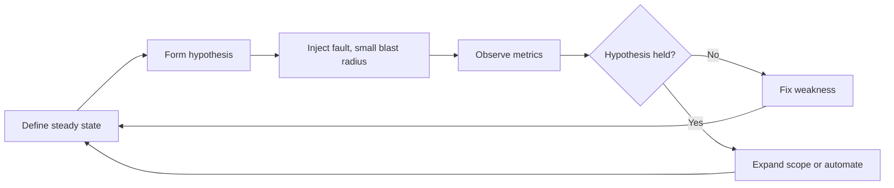

# Reliability Testing and Chaos Engineering

> Reliability testing checks how a system behaves under load, failure and stress, and chaos engineering does it by deliberately injecting faults to learn whether resilience is real or assumed.

## Overview

A system can pass every functional test and still fail in production. Functional tests ask "does it do the right thing when everything works?" Reliability testing asks "does it keep doing something acceptable when parts do not work?" Disks fill, networks partition, dependencies slow down, certificates expire, a deploy goes wrong, and a downstream service returns errors for ten minutes. Those events are not exceptional at scale. They are routine.

Resilience features such as retries, timeouts, circuit breakers, failover, and graceful degradation are code, and untested code usually does not work. A failover path that has never been exercised is a hypothesis. Chaos engineering turns the hypothesis into evidence by exercising the failure on purpose, under control, while observing the system.

The field defines chaos engineering as experimentation on a system to build confidence in its ability to withstand turbulent conditions in production. The emphasis is on experiment, not on breaking things for its own sake. Without a hypothesis, a way to measure, and a way to stop, it is merely sabotage.

## Core Concepts

### Kinds of reliability testing

| Kind | Question | Typical technique |
|------|----------|-------------------|
| Load testing | Does it meet targets at expected traffic? | Simulated traffic; see [Load Testing](../12-performance-scalability/load-testing.md) |
| Stress testing | Where does it break, and how? | Increase load beyond capacity |
| Soak testing | Does it degrade over hours or days? | Sustained load; watch memory, connections, disk |
| Spike testing | Can it absorb a sudden surge? | Abrupt step in traffic |
| Failure injection | Does it tolerate specific faults? | Kill processes, add latency, drop packets, return errors |
| Recovery testing | Does it come back correctly? | Restart, restore from backup, fail over |
| Disaster recovery drill | Can we meet recovery objectives? | Rehearse region loss, data restore |
| Game day | Can people and process cope? | Scheduled team exercise with injected failure |

Functional correctness under faults is its own concern. A retry that sends a payment twice is a failure of correctness, not just availability.

### Steady state and hypotheses

A chaos experiment starts with a **steady state**: a measurable indicator of normal behavior, usually from business or service metrics rather than internal ones. Examples: successful checkouts per minute, p99 request latency, error rate, queue depth.

The cycle:

1. **Define steady state** with metrics you already collect.
2. **Hypothesize** that it will hold under a specific fault: "If one database replica is terminated, checkout success rate stays within its normal range."
3. **Inject the fault** with a limited blast radius.
4. **Observe** and compare against the control or baseline.
5. **Learn and fix.** If the hypothesis fails, you found a weakness cheaply. If it holds, confidence grows.
6. **Automate** and repeat, because systems change.

### Principles of chaos engineering

The community's published principles (principlesofchaos.org) include: build a hypothesis around steady-state behavior, vary real-world events, run experiments in production where feasible, automate experiments to run continuously, and minimize blast radius. Running in production is where the real behavior lives, but it is an advanced step. Start in a staging or test environment and move toward production as controls and confidence mature.

### Fault types to consider

- **Resource faults**: CPU saturation, memory pressure, full disk, exhausted file descriptors or connection pools.
- **Network faults**: added latency, packet loss, partitions, DNS failure, certificate expiry.
- **Dependency faults**: slow responses, error responses, malformed responses, total unavailability.
- **Process and host faults**: crash, restart, node loss, zone loss.
- **State faults**: clock skew, corrupted or stale data, a restore from backup.
- **Human and process faults**: a bad configuration push, a failed deploy, a revoked credential.

Slow is usually worse than down. A dependency that returns errors fast is easy to handle. One that responds after thirty seconds ties up threads and connections and spreads failure upward. Test latency injection, not only outright failure. See [Distributed Systems](../13-distributed-systems/README.md) for the underlying failure model.

### The resilience patterns being tested

| Pattern | What it should do | What the experiment checks |
|---------|-------------------|----------------------------|
| Timeout | Bound waiting | Every outbound call has one, and it is shorter than the caller's |
| Retry with backoff and jitter | Recover from transient faults | Retries do not amplify load or duplicate side effects |
| Circuit breaker | Stop calling a failing dependency | It opens, then probes and closes correctly |
| Bulkhead | Contain failure to a pool | One slow dependency cannot exhaust shared threads |
| Load shedding | Reject excess work early | The system degrades predictably, not collapsing |
| Idempotency | Make retries safe | A repeated request produces one effect |
| Failover | Shift to a healthy replica | Switch time and data consistency are acceptable |
| Graceful degradation | Offer reduced function | Core flows survive loss of non-critical features |

Michael Nygard's *Release It!* catalogues these patterns and the failures they address.

### Service level objectives as the yardstick

Reliability is measured against an objective. A **service level indicator** (SLI) is a measurement, such as the fraction of requests that succeed within a latency bound. A **service level objective** (SLO) is the target for it. The **error budget** is the allowed shortfall. Experiments are most useful when tied to these. Google's *Site Reliability Engineering* explains the model. An experiment that would burn a significant portion of the error budget needs strong justification. A system with a healthy budget has room to learn through experiments.

### Game days and drills

A game day is a planned exercise where the team deliberately triggers a failure scenario and practices detection, diagnosis, and response. It tests people, alerts, runbooks, and dashboards, not only code. Often the finding is that the alert did not fire, the runbook was stale, or nobody knew who could approve a failover. Backup restoration is the classic example: a backup is only a backup if you have restored from it.

## Trade-offs

| Choice | What it buys | What it costs |
|--------|--------------|---------------|
| Experiments in production | Real traffic, real configuration | Risk of customer impact; needs strong controls |
| Experiments in staging | Safety | Differences from production hide weaknesses |
| Continuous automated chaos | Catches regression in resilience | Tooling, maintenance, alert noise |
| Occasional game days | Exercises humans and process | Infrequent; results age |
| Large blast radius | Realistic scale | Greater potential harm |
| Small blast radius | Safe learning | May not reveal scale-dependent failures |
| Aggressive timeouts and fast failure | Quick recovery | False failures during slow but healthy periods |
| Generous retries | Higher success on transient faults | Retry storms and duplicate effects |
| Redundancy everywhere | Fault tolerance | Cost and complexity; more failure interactions |

A fair caution: chaos engineering has prerequisites. If you lack monitoring, cannot tell whether the system is healthy, or know already that a single point of failure exists, you do not need an experiment to learn that. Fix the known weakness first. Chaos is for finding unknown weaknesses once the known ones are handled.

## Failure Modes

**Experiments without observability.** Fault injected, nobody can tell what happened. Make steady-state metrics, tracing, and alerting prerequisites.

**Uncontrolled blast radius.** The experiment affects all customers or a shared dependency. Limit to a small slice of traffic, a single instance, or a test tenant. Have a tested abort mechanism, and a named person who can press it.

**Retry storms.** A dependency slows, clients retry immediately and in lockstep, load multiplies, the dependency never recovers. Detect in experiments by watching request amplification. Prevent with exponential backoff, jitter, retry budgets, and load shedding.

**Cascading failure.** One component's failure propagates because timeouts are longer than the caller's or pools are shared. Test by injecting latency in a leaf dependency and watching upstream saturation.

**Untested failover.** A standby exists, but replication was broken for weeks, or the standby lacks capacity, or configuration differs. Rehearse failovers regularly and verify data freshness and capacity.

**Backups never restored.** The restore process fails when needed because of missing keys, a changed schema, or untested tooling. Schedule restore drills and measure the time against your recovery objectives.

**Silent degradation.** The system "tolerates" a fault by returning wrong or stale data without telling anyone. Experiments should check correctness as well as availability.

**Metastable failure.** After a trigger such as a spike or brief outage, the system remains stuck in a bad state because retries, cold caches, or queue backlogs keep load above capacity even after the trigger ends. Test recovery, not just survival: remove the fault and verify the system returns to steady state on its own.

**Alerts that never fire or always fire.** Experiments reveal alerts with wrong thresholds or no routing. Treat each experiment as a test of detection too.

**Experiment fatigue and theater.** Experiments become a compliance ritual with no follow-up. Each finding must produce a tracked fix, and each fix should be re-verified by repeating the experiment.

**Testing resilience only in the application.** Infrastructure, DNS, certificates, and credentials expire or fail too. Include expiry and rotation in drills.

## In Practice

### Starting small

1. Pick one critical flow and its SLI.
2. List its dependencies. For each, write what should happen if it is slow, erroring, or absent.
3. Choose the least risky experiment, for example in staging: add latency to one dependency.
4. Predict the outcome in writing before running it.
5. Run it with someone watching dashboards and a stop condition defined (for example, abort if error rate exceeds a stated threshold).
6. Record what actually happened and open tickets for the gaps.
7. Repeat with a different fault, then move toward production with small slices.

### Worked example: slow payment provider

Hypothesis: if the payment provider's p99 latency rises to several seconds, checkout still completes for most users because calls time out and are retried once, and the cart is preserved.

Experiment: inject added latency on calls to a stub or a small slice of production traffic.

Possible findings and fixes:

| Observation | Fix |
|-------------|-----|
| Web threads all blocked, unrelated pages slow | Add timeout and bulkhead for the payment pool |
| Retries doubled the request rate to the provider | Add jittered backoff and a retry budget |
| Some customers charged twice | Add an idempotency key on payment requests |
| No alert fired for 15 minutes | Alert on payment success rate and latency, with routing |

Four findings from one hour. None required a production outage to discover.

### Developer vs. engineer

A developer adds a retry because the call sometimes fails. An engineer asks what the retry does to the dependency under load, whether the operation is idempotent, how long the caller waits in total, and how they will know it works. Then they prove it with a fault-injection test.

### When AI generates code

Generated client code frequently includes retries, or none, with default timeouts that are unbounded or very long. It rarely adds jitter, budgets, or idempotency. Check:

- Is there an explicit timeout on every network call, and does it fit within the caller's budget?
- Are retries limited, backed off, and applied only to idempotent or keyed operations?
- Does error handling distinguish transient from permanent failures?
- Are resources (connections, threads, file handles) released on every path?

Write a fault-injection test for each resilience claim in generated code. A claim that was not tested should not be trusted.

### Checklist

- [ ] Each critical flow has an SLI and an SLO.
- [ ] Every outbound call has a timeout, and timeouts nest correctly.
- [ ] Retries use backoff and jitter, and apply only to safe operations.
- [ ] Failover and backup restore have been exercised, with measured times.
- [ ] Experiments have a hypothesis, a blast radius, and an abort condition.
- [ ] Findings produce tracked fixes and are re-tested.
- [ ] At least one game day per year exercises the people and runbooks.

## Further Reading

- Michael T. Nygard, *Release It!: Design and Deploy Production-Ready Software*. Stability patterns and anti-patterns, including timeouts, circuit breakers, and bulkheads.
- Casey Rosenthal and Nora Jones, *Chaos Engineering: System Resiliency in Practice*. Practices and organizational lessons from the field.
- Ali Basiri et al., "Chaos Engineering" (IEEE Software, 2016). An early practitioner account of the discipline.
- "Principles of Chaos Engineering" (principlesofchaos.org). The community statement of method.
- Betsy Beyer et al. (eds.), *Site Reliability Engineering*, chapters on service level objectives, handling overload, and addressing cascading failures.
- Nathan Bronson et al., "Metastable Failures in Distributed Systems" (HotOS 2021). A precise description of self-sustaining failure states.

Back to the section: [Testing and Quality](./README.md)
