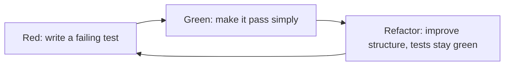

# TDD and Designing for Testability

> Test-driven development uses tests to drive small design steps, and testability is the property of code that makes any testing cheap; both reward the same structural habits.

## Overview

Code is testable when you can put it in a known state, exercise it, and observe the result without elaborate machinery. Testability is mostly a design property, not a testing technique. A function that reads the clock, queries a database, and sends an email in the middle of a calculation is hard to test because it is doing too much and hiding its dependencies. Fixing it improves the design as well as the tests.

Test-driven development (TDD) is a working method built on this idea. You write a failing test first, make it pass with the simplest change, then clean up. The cycle is short, and the tests shape the design as it grows. TDD is also contested. Some engineers use it everywhere. Others use it selectively. Others find it unhelpful for exploratory work. This topic presents it as a tool with a clear mechanism, benefits, and limits, so you can decide when to reach for it.

The deeper skill is not the ritual of writing the test first. It is learning to listen to what difficulty in testing says about the design.

## Core Concepts

### The red-green-refactor cycle



1. **Red.** Write one small test for behavior that does not exist yet. Run it. Watch it fail, and check that it fails for the reason you expect. A test that has never failed has not been shown to detect anything.
2. **Green.** Write the least code that makes it pass. It is acceptable, even encouraged, to be crude here.
3. **Refactor.** With tests green, remove duplication and improve names and structure. Run the tests after each small step.

Each cycle takes minutes. The discipline is in keeping steps small enough that when a test fails, you know which change caused it.

### What TDD claims to give you

- **A safety net built as you go**, so refactoring is routine.
- **Design pressure**: to write the test first you must decide the interface from the caller's perspective.
- **Focus**: one failing test is a concrete goal.
- **Specification by example**: the tests record intent.

### Two schools

Practitioners describe two styles. They are tendencies, not factions.

| Aspect | Classicist (state-based) | Mockist (interaction-based) |
|--------|--------------------------|------------------------------|
| Starting point | Inside-out: build small units, compose them | Outside-in: start at the entry point, mock collaborators not yet written |
| Verification | Check resulting state or return values | Check messages sent to collaborators |
| Doubles | Real objects where cheap; fakes for the rest | Mocks for collaborators |
| Risk | Slower to find the shape of the outer API | Tests coupled to internal conversation |

Freeman and Pryce's *Growing Object-Oriented Software, Guided by Tests* describes the outside-in approach. Kent Beck's *Test-Driven Development: By Example* shows the classicist style. Both are valid. Choose by the problem: logic-heavy code suits state-based tests, and orchestration across several collaborators may suit interaction tests at the seams.

### Designing for testability

A handful of structural habits make code testable regardless of whether you do TDD.

**Make dependencies explicit.** Pass collaborators in rather than reaching out to globals or constructing them internally.

```python
# Hard to test: hidden clock and hidden I/O
def is_trial_expired(user):
    return datetime.now() > user.trial_end

# Testable: the time is an input
def is_trial_expired(user, now):
    return now > user.trial_end
```

Where passing a value is clumsy, inject an interface such as a `Clock` and supply a fixed one in tests.

**Separate decisions from effects.** Put logic in pure functions that take values and return values. Put I/O at the edges. This pattern, often called functional core and imperative shell, means the interesting logic is tested without any doubles, and the thin shell is covered by a few integration tests.

```python
def plan_refund(order, policy, now):
    """Pure: decides what to do."""
    if now - order.paid_at > policy.window:
        return RefundDenied(reason="window_expired")
    return RefundApproved(amount=order.total - order.restocking_fee)

def handle_refund_request(order_id, gateway, repo, clock):
    """Shell: loads, calls the pure function, performs effects."""
    order = repo.get(order_id)
    decision = plan_refund(order, POLICY, clock.now())
    if isinstance(decision, RefundApproved):
        gateway.refund(order.payment_id, decision.amount)
    repo.record(order_id, decision)
```

**Keep interfaces narrow.** A class with ten collaborators needs ten setups in every test. A constructor that is painful to call in a test is telling you the class has too many responsibilities.

**Avoid hidden global state.** Singletons, module-level caches, and static mutable fields leak state between tests and force ordering.

**Prefer observable outcomes.** If the only way to verify behavior is to inspect private fields, expose the outcome through a legitimate query or event instead of opening up internals for tests.

**Seams.** Michael Feathers uses "seam" for a place where you can alter behavior without editing the code at that place, such as an interface parameter or a configuration point. Legacy code is hard to test because it lacks seams. You create them with small, safe refactorings, then add tests, then change behavior.

### Test smells that signal design problems

| Smell in the test | Likely design cause |
|-------------------|---------------------|
| Huge setup | Too many dependencies; class does too much |
| Many mocks | Excess coupling |
| Needs the database to check a calculation | Logic mixed with persistence |
| Must run tests in order | Hidden shared state |
| Cannot test without real time | Clock not injected |
| Tests break on every refactor | Tests coupled to implementation |

Treat these as design feedback rather than testing problems to be worked around with heavier tooling.

### Testing legacy code

For code without tests, first write **characterization tests**: tests that record what the code currently does, so you can detect unintended change. They do not say the behavior is right. Then create seams, refactor in small steps under that safety net, and add proper tests for new behavior. Feathers' *Working Effectively with Legacy Code* is the standard guide.

## Trade-offs

| Choice | What it buys | What it costs |
|--------|--------------|---------------|
| Strict TDD | Tight feedback, tests for everything written | Slower start on unfamiliar problems; risk of over-specifying early designs |
| Test-after | Freedom to explore, then lock in | Tests may never be written; code may need reshaping to be testable |
| Spike, then discard and TDD | Exploration plus clean result | Discipline to really throw the spike away |
| Dependency injection everywhere | Easy substitution | More indirection; wiring code; risk of interfaces with one implementation |
| Functional core, imperative shell | Easy logic tests | Requires modeling effects as data; unfamiliar in some codebases |
| Mock-heavy outside-in | Drives API design from the caller | Fragile tests if overused |
| Designing for tests only | Short-term testability | Risk of bending production code for tests rather than for clarity |

TDD's empirical evidence is mixed. Studies exist with varied results, and much of the debate is about experience and anecdote. A fair summary: many experienced engineers find it improves their design and confidence for logic-heavy work, while others find it adds little for UI exploration, data-heavy scripts, or throwaway code. Use it where the feedback loop pays for itself, and be honest about where it does not.

## Failure Modes

**Writing tests that duplicate the implementation.** The test computes the expected value using the same algorithm as the code. Both are wrong together. Fix by choosing expected values from the specification, a worked example, or an independent calculation.

**Over-specifying early.** Locking in internal structure with tests before the design settles makes every change expensive. Test behavior through the public interface, and keep early tests coarse until the shape is clear.

**Giant steps.** Writing twenty tests then implementing everything. When something fails, nothing indicates why. Keep the cycle small enough that a red test points to the last change.

**Skipping the refactor step.** Red and green without refactor produces passing but messy code. Over time the tests pass and the code decays. Treat refactoring as a mandatory part of the cycle.

**Testability damage.** To make private logic testable, a team makes everything public or adds test-only hooks, degrading encapsulation. Better: test through the public interface, or extract the logic into its own unit with its own interface.

**Interface proliferation.** Every class gets an interface purely for mocking. Code becomes harder to read and nobody can find the real implementation. Introduce an abstraction when there is a real boundary or a second implementation, not by reflex.

**False confidence from passing tests written after the fact.** Tests written after the code often pass at once, and you never saw them fail. Detect by temporarily breaking the production code and checking that the test fails.

**Cargo-cult adoption.** A mandate of "100% TDD" or "100% coverage" produces ritual without judgment. Detect by looking at test quality in code review, not only at counts.

## In Practice

### A short TDD walk-through

Requirement: a function that formats a duration in seconds as `1h 02m 03s`, omitting zero leading units.

1. Red: test that `format_duration(3)` returns `"3s"`. It fails because the function does not exist.
2. Green: return `f"{seconds}s"`.
3. Red: test `format_duration(65)` returns `"1m 05s"`. Fails.
4. Green: add minute handling.
5. Red: test `format_duration(3723)` returns `"1h 02m 03s"`. Fails.
6. Green: add hours.
7. Red: test `format_duration(0)`. Decide what it should return (`"0s"`), see it pass or fail, adjust.
8. Refactor: extract divmod logic, rename variables, keep tests green.

Each test came from a concrete example, and the edge case at zero was discovered as a question to answer, not found in production.

### When TDD tends to pay off

- Business rules and calculations with many cases.
- Parsers, formatters, and state machines.
- Bug fixes: write a test that reproduces the bug first, watch it fail, then fix. This is the single most broadly useful form of test-first.
- Refactoring existing code under characterization tests.

### When it tends to pay less

- Exploring an unfamiliar API or an unclear requirement. Spike first, learn, then write tests.
- Visual layout work where judgment is by eye.
- Thin glue code better covered by an integration test.

### Developer vs. engineer

A developer finds a function hard to test and reaches for a heavier mocking framework. An engineer reads the difficulty as a message, extracts the decision logic into a pure function, and the mocking need disappears. The engineer fixes the design, not the symptom.

### When AI generates code and tests

- If an assistant writes code and tests together in one step, you lose the red phase. The tests may be shaped by the implementation. Prefer to write or at least specify the test cases yourself from the requirement, then let the tool implement against them.
- Ask the assistant to propose edge cases, then judge them. It is a good brainstorming partner for boundaries you forgot.
- Generated code often reaches for globals and direct calls to time, randomness, and I/O. Refactor to inject them before accepting.
- Running the tests is not enough. Break the code on purpose and watch them fail.

### Checklist

- [ ] Bug fixes start with a test that reproduces the bug.
- [ ] Time, randomness, and I/O are injected or isolated at the edges.
- [ ] Core logic can be tested without doubles.
- [ ] Constructors have few dependencies.
- [ ] You have seen each new test fail before it passed.
- [ ] Refactoring happens on green, in small steps.
- [ ] Test difficulty is treated as design feedback.

## Further Reading

- Kent Beck, *Test-Driven Development: By Example*. The original, with worked examples of the cycle.
- Steve Freeman and Nat Pryce, *Growing Object-Oriented Software, Guided by Tests*. The outside-in, mock-assisted style in depth.
- Michael Feathers, *Working Effectively with Legacy Code*. Seams, characterization tests, and techniques for bringing untested code under control.
- Gary Bernhardt, "Boundaries" (conference talk) and his "Functional Core, Imperative Shell" material. Origin of the pattern's popular naming.
- Martin Fowler, Kent Beck and David Heinemeier Hansson, "Is TDD Dead?" (recorded conversation series, 2014). An honest airing of the criticisms and defenses.

Back to the section: [Testing and Quality](./README.md)
