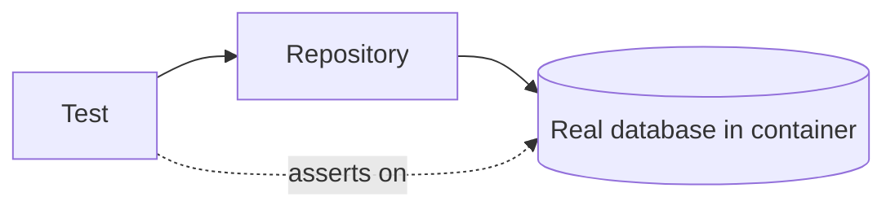

# Unit, Integration and End-to-End Testing

> Each test level checks a different kind of risk, and using each for what it does best is what keeps a suite fast, trustworthy and useful.

## Overview

The three familiar levels of automated testing differ in how much of the system they exercise at once. A unit test checks a small piece of logic in isolation. An integration test checks that components work together across a real boundary, such as a database or a network protocol. An end-to-end test drives the whole system the way a user or client would.

The words are used loosely, and teams disagree about their boundaries. That is acceptable as long as your team has an explicit definition. What matters is the underlying question: what is this test allowed to touch, and what risk is it meant to catch? See [Test Strategy and the Test Pyramid](./test-strategy-and-the-test-pyramid.md) for how to choose the mix.

Writing a passing test is easy. Writing one that fails for the right reason, only for that reason, and tells you quickly what broke is the skill. This topic covers how to build each level well.

## Core Concepts

### Unit tests

A unit test exercises a small unit of behavior, usually a function or a class, with no slow or nondeterministic dependencies. No network, no real database, no wall clock, no filesystem unless it is trivially local.

Good unit tests share traits:

- **Fast and deterministic.** Same inputs, same result, every time.
- **Focused.** One behavior per test, with a name that states it.
- **Behavior-oriented.** They check what the unit promises, not how it does it.
- **Readable.** The structure is arrange, act, assert, and a reader can see the scenario without reading the implementation.

```python
def test_discount_never_makes_total_negative():
    cart = Cart(items=[Item(price_cents=500)])
    cart.apply(Discount(amount_cents=800))
    assert cart.total_cents() == 0
```

This test names a business rule. It does not mention internal fields or helper calls. If the implementation changes from a loop to a reduction, the test is untouched.

Unit tests are best for pure logic: calculations, parsing, validation, state machines, and algorithms. They are weak at detecting configuration errors, serialization mismatches, and incorrect assumptions about another system.

### Test doubles

When a unit has collaborators, you can replace them with doubles. The vocabulary below follows Gerard Meszaros and Martin Fowler.

| Double | Purpose |
|--------|---------|
| Dummy | Fills a parameter that is never used |
| Stub | Returns canned answers |
| Fake | A working but simplified implementation (for example, an in-memory repository) |
| Spy | Records calls for later inspection |
| Mock | Pre-programmed with expectations about calls; fails if they are not met |

Prefer fakes and stubs over mocks where you can. A fake in-memory repository lets the test check resulting state. A mock checks the conversation, which couples the test to the implementation. Use mocks where the interaction itself is the behavior, for example "an email was sent exactly once".

A useful rule: mock what you own at the boundary, and do not mock what you do not own. Wrap a third-party client in a thin adapter, double the adapter in unit tests, and verify the adapter itself with an integration test against the real thing or a faithful substitute.

### Integration tests

An integration test checks that two or more components work together through a real interface. Examples:

- A repository class against a real database engine, checking queries, constraints, transactions, and migrations.
- An HTTP handler through the real routing, serialization, and middleware stack.
- A consumer reading from a real message broker.
- A client library calling a stub server that speaks the real protocol.

Integration tests catch what unit tests structurally cannot: SQL that is valid in the mock but wrong in the database, a JSON field renamed on one side, a transaction that does not roll back, a missing index on a unique constraint.

Practical points:

- **Use the real engine.** An in-memory substitute with different semantics (a different SQL dialect, no constraint enforcement) gives false comfort. Containers make real engines easy to start per test run.
- **Isolate data.** Each test creates what it needs and cleans up, or runs in a transaction that rolls back, or uses a fresh schema. Shared mutable data is the main cause of order-dependent failures.
- **Control time and randomness.** Inject a clock and a seeded random source.
- **Keep scope tight.** Test one boundary at a time. If an integration test needs five services, it is drifting toward end-to-end.



### End-to-end tests

An end-to-end test runs through the deployed system from its outer interface: a browser driving the UI, or a client calling the public API, with real services and data stores behind it. It verifies that the assembled system delivers a user journey.

They have unique value: configuration, deployment wiring, authentication flows, and cross-service behavior only appear here. They also have unique costs: slowness, environment setup, flakiness from timing and shared data, and poor failure localization.

Guidelines:

- Cover a small number of critical journeys (sign-up, checkout, the one flow that earns revenue). Do not test every validation rule through the UI.
- Drive tests through stable interfaces. For browsers, use roles and accessible labels rather than layout-dependent selectors.
- Wait for conditions, not for fixed durations. Fixed sleeps are slow when generous and flaky when tight.
- Create test data through an API or seeding step, not by clicking through the UI each time.
- Make each test independent. No test relies on another having run.
- Retries can hide flakiness. If you retry, record that you did and track the rate.

### Smoke and acceptance tests

A **smoke test** is a tiny post-deploy check that the system is alive and its main path works. An **acceptance test** checks that a feature meets an agreed criterion from the user's point of view. Either may be implemented at the integration or end-to-end level. Keep smoke tests few and fast, as they gate deployments.

### Test data

Bad test data creates brittle tests. Options:

| Approach | Strength | Weakness |
|----------|----------|----------|
| Inline literals | Obvious in the test | Verbose |
| Builders or factories | Defaults with targeted overrides | Hidden defaults can obscure what matters |
| Shared fixtures | Reuse | Coupling; changing a fixture breaks distant tests |
| Anonymized production data | Realistic shapes | Privacy risk; hard to reason about |
| Generated data | Wide input coverage | Needs care for reproducibility |

Prefer builders: make the one field that matters visible in the test and let defaults fill the rest. Never use real personal data in test environments without a deliberate privacy review.

## Trade-offs

| Choice | What it buys | What it costs |
|--------|--------------|---------------|
| Isolating with mocks | Speed, focus | Mock behavior may diverge from reality |
| Real database in integration tests | Fidelity to queries and constraints | Slower, requires container tooling |
| In-memory fake database | Very fast | Semantic gaps; can pass where production fails |
| One assertion per test | Clear failures | More tests, more setup |
| Several assertions per test | Compact | A failure at the first assertion hides the rest |
| Parallel test execution | Shorter runs | Requires isolated data and no shared global state |
| Browser end-to-end tests | Real user path | Slow; flaky on timing and rendering |
| API-level end-to-end tests | Faster, more stable than UI tests | Does not check the UI layer |
| Retrying failed tests | Fewer red builds | Masks real intermittent bugs |

## Failure Modes

**Tests that assert on mocks, not behavior.** A test sets up a mock to return a value and then asserts the mock returned it. Nothing real is checked. Detect by deleting the production logic and seeing whether the test still passes.

**Mock drift.** A stubbed dependency returns a shape that the real service no longer produces. Production breaks, tests stay green. Prevent with contract tests (see [Contract and Property-Based Testing](./contract-and-property-based-testing.md)) and periodic integration runs against the real thing.

**Shared state across tests.** Test B passes only if test A ran first. The failure appears when tests run in a different order or in parallel. Detect by randomizing order in CI. Prevent by giving each test its own data and resetting global state.

**Time bombs.** Tests that depend on the current date, a time zone, or a daylight-saving boundary pass for months and then fail on a particular day. Inject the clock and test the boundaries deliberately: month ends, leap days, zone changes.

**Slow, unbounded end-to-end suites.** Every bug adds a new end-to-end test. Within a year the suite takes hours. Set a budget, and when a bug is found, first ask whether a lower-level test can reproduce it.

**Environment-coupled tests.** Tests rely on a specific database state in a shared staging environment. Someone else changes the data and tests fail. Use ephemeral, per-run environments where possible.

**Asserting too much.** A test compares an entire serialized response, so any harmless change breaks it. Assert on the fields that matter. Snapshot tests are convenient but are often approved without being read; review snapshot diffs as carefully as code.

**Silent skips.** Tests are marked skipped during an incident and never restored. Track skipped tests as debt with a count that must trend down.

**Network-dependent tests in CI.** Tests call real third-party services. The service has an outage, and your pipeline fails. Replace with a local fake and keep a small, separately scheduled check against the real service.

## In Practice

### Choosing the level for a new behavior

Ask in order:

1. Is it pure logic? Unit test.
2. Does the risk lie in how we talk to a database, queue, or another service? Integration test.
3. Does the risk lie in deployment wiring or a multi-service user journey? End-to-end test, and only if it is critical.

### Worked example: order placement

Requirements: an order is rejected if stock is insufficient; stock is decremented atomically; a confirmation message is published.

| Behavior | Level | Why |
|----------|-------|-----|
| Total calculation with discounts and tax rounding | Unit | Pure logic with many edge cases |
| Reject when requested quantity exceeds stock | Unit with a fake repository | Rule is logic; state is visible via fake |
| Two concurrent orders cannot both take the last item | Integration with a real database | Depends on transaction and constraint behavior |
| Confirmation message is published after commit, not before | Integration with a real broker or outbox table | Depends on ordering across a boundary |
| User can add to cart and check out | One end-to-end test | Confirms the journey is wired correctly |

Most of the rows are not end-to-end. The concurrency row is the interesting one: no unit test with a mock can reveal it. Only a real database under concurrent load exposes a lost update.

### A good test name

A name should read as a sentence: `rejects_order_when_stock_is_insufficient`, not `test_order_3`. When a test fails in CI, the name is the first thing anyone reads.

### Developer vs. engineer

A developer writes a test that calls the function and asserts it returns what it returned. An engineer writes the test from the requirement, runs it first to confirm it fails without the feature, and then makes it pass. The engineer also asks what the test would not notice.

### When AI generates tests

- Generated unit tests often assert the current output as truth. If the code has a bug, the test enshrines it. Check expected values against the requirement.
- Generated integration tests frequently use mocks where a real dependency is needed. Ask whether the test could catch a wrong SQL statement.
- Generated end-to-end tests tend to use brittle selectors and fixed sleeps. Replace them with stable locators and condition-based waits.
- Confirm the test fails when the behavior is broken. A test you have never seen fail has not been shown to work.

### Checklist

- [ ] Your team has written definitions of unit, integration, and end-to-end tests.
- [ ] Unit tests have no network, disk, or real clock.
- [ ] Integration tests run against the real engine you deploy on.
- [ ] End-to-end tests cover only critical journeys.
- [ ] Each test creates and owns its data.
- [ ] Test order is randomized in CI.
- [ ] Every new test has been seen to fail for the right reason.

## Further Reading

- Gerard Meszaros, *xUnit Test Patterns: Refactoring Test Code*. Test doubles, fixtures, and test smells in depth.
- Martin Fowler, "Mocks Aren't Stubs". Clarifies test double terminology and the classic versus mockist styles.
- Martin Fowler, "Eradicating Non-Determinism in Tests". Practical causes of flakiness and remedies.
- Vladimir Khorikov, *Unit Testing: Principles, Practices, and Patterns*. A rigorous treatment of what makes a unit test valuable and of mocking trade-offs.
- Titus Winters, Tom Manshreck, Hyrum Wright (eds.), *Software Engineering at Google*, testing chapters. Large-scale experience with test size and double usage.

Back to the section: [Testing and Quality](./README.md)
